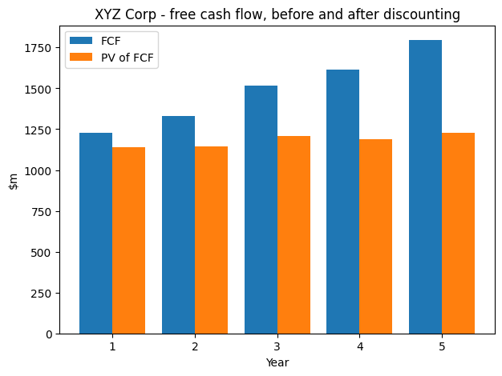

# DCF Valuation Model

Personal project: a discounted cash flow model written in Python, step by step.

I am a Master's student in corporate finance and I had only ever built DCFs in Excel. I wanted to code one from scratch, mostly to check that I really understood each step instead of just filling cells. The notebook prints every intermediate result, so the whole calculation can be followed from the operating assumptions down to the implied share price.

The WACC is calculated from CAPM inputs (risk-free rate, beta, market premium, credit spread) instead of being assumed, and the cash flows are built from revenue.

The same method applied to a real company, with 10-K data and a regression beta: [Lockheed Martin DCF](https://github.com/louischarpentier83-source/lockheed-martin-dcf).

[](https://colab.research.google.com/github/louischarpentier83-source/dcf-valuation-model/blob/main/DCF.ipynb)



## What the notebook does

1. Inputs
2. Cost of capital: levered beta, cost of equity, cost of debt, WACC
3. Free cash flow projection
4. Discounting and enterprise value
5. Enterprise value to share price
6. Sensitivity analysis
7. Chart

## Formulas

```
Levered beta      = Unlevered beta x (1 + (1 - t) x D/E)              [Hamada]
Cost of equity    = Risk-free rate + Levered beta x Market premium    [CAPM]
Cost of debt      = Risk-free rate + Credit spread
WACC              = We x Cost of equity + Wd x Cost of debt x (1 - t)

NOPAT             = EBIT x (1 - tax rate)
NWC               = Inventory + Receivables - Payables
FCF               = NOPAT + D&A - CapEx - Change in NWC

Terminal RONIC    = WACC + RONIC spread
Terminal FCF      = NOPAT(final year) x (1 + g) x (1 - g / RONIC)
Terminal value    = Terminal FCF / (WACC - g)                  [Gordon Growth]
Enterprise value  = sum of PV(FCF) + PV(Terminal value)
Excess cash       = Cash - Operating cash (% of revenue)
Equity value      = Enterprise value - Debt + Excess cash - Leases - Pensions - Minorities
Price per share   = Equity value / (Shares + Dilutive shares)
```

Two choices I had to make. The market capitalisation used for the WACC weights is based on the current share price and not on the price the model produces, otherwise the calculation would be circular. And the WACC weights use gross debt while the equity bridge deducts debt net of excess cash only.

Terminal RONIC is set at WACC + 2 points because it applies only to new investments, not to capital already in place (the value driver logic from McKinsey's *Valuation*), which is a prudent assumption close to that book's RONIC = WACC baseline, and it implies terminal CapEx of about 1.55x D&A (1.2x over the forecast).

In the equity bridge, the operating cash of $200m (2% of revenue) is an assumption. Lease liabilities, pension provisions and minority interests are set to zero because the company is fictional. Real lease liabilities would require an IFRS 16 restatement of the FCF, so that lease payments are not counted twice.

## Results

The figures below come from a sample company, not a real one. The point of the project is the method.

| | |
|---|---|
| WACC | 7.87% |
| Enterprise value | $24,938m |
| Terminal value as % of EV | 76.3% |
| Implied share price | $44.48 |
| Current share price | $32.00 |

Across a +/-100bp WACC band and a 1% to 3% terminal growth band, the implied price ranges from $37 to $57. That range is the reason the sensitivity table is in there.

A second table crosses the terminal EBITDA margin (21% to 29%) with yearly revenue growth (-2 to +2 points): its most adverse scenario ($34) stays above the current share price of $32 at a constant WACC, but falls below it (about $29) if the WACC rises by 100bp, so it is not a floor on value.

## Running it

Click the Colab badge to open the notebook in a browser, or run it locally:

```bash
pip install -r requirements.txt
jupyter notebook DCF.ipynb
```

All the inputs are in section 1, nothing else needs to be changed.

## What I would improve

- CapEx, D&A and working capital are simple percentages of revenue. A proper model would separate maintenance capex from growth capex.
- The terminal value is about 76% of the enterprise value, so the result depends a lot on the perpetual growth rate.
- Cash flows are discounted as if received at year end, with no mid-year convention.
- Beta is an input. Estimating it with a regression against a market index would be the next step.

## Author

Louis Charpentier - [LinkedIn](https://www.linkedin.com/in/lchrpt/)
